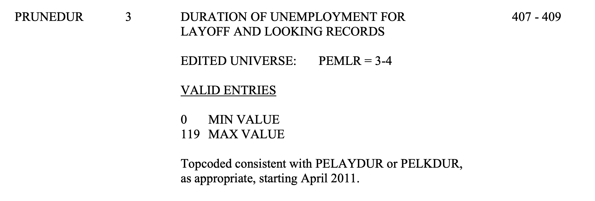
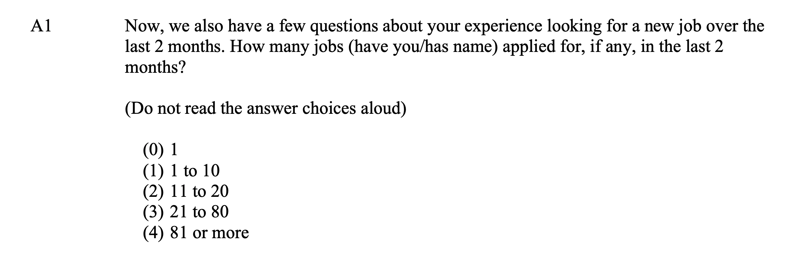
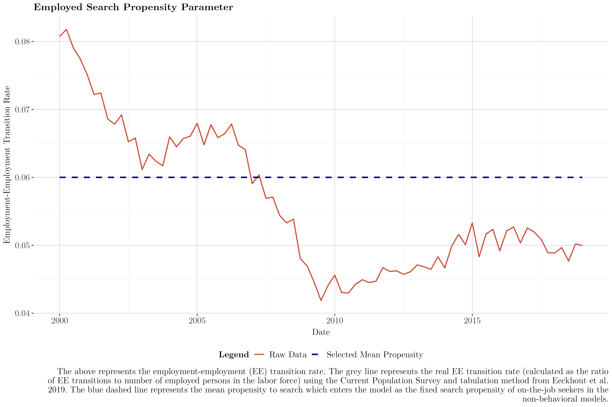
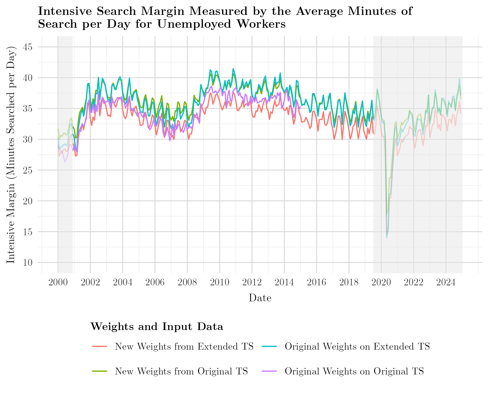

```{r setup, include=FALSE, message = FALSE}
knitr::opts_chunk$set(echo = FALSE, message = FALSE, warning = FALSE, cache = FALSE, fig.width = 6.27, fig.height = 5.02, dev = "ragg_png", dpi = 300)

library(tidyverse)
library(here)
library(janitor)
library(gridExtra)
library(MASS)
library(kableExtra)
library(knitr)
library(pdftools)
library(haven)
library(lubridate)
library(vctrs)
library(gets)
library(patchwork)
library(modelsummary)
library(conflicted)
source(here('code/formatting/plot_dicts.R'))
conflict_prefer_all("dplyr", quiet = TRUE)
conflicts_prefer(patchwork::area)

rename_fun <- function(x){
  return(str_to_title(gsub("_", " ", x)))
}

```


The model's central functionality relies on a variety of behavioral
mechanisms that are parametrized econometrically using micro data.
Furthermore, the model relies on additional sources of micro data for
validation. In the following section we outline, first, the data and
analysis used to derive the model's behavioral parameters, followed by
an inventory of the data used to validate various model outputs. We note
where we make use of methodology employed or constructed by other authors.

### Application Effort and Learning Dynamics: Applications Sent {.tabset}

First, we employ data from a supplementary survey designed by the US Bureau of Labor Statistics conducted as part of the Current Population Survey on the application effort of unemployed job-seekers to discipline our behavioral mechanism for search effort. More specifically, in 2018 (May, September) and 2022 (February, May), the Bureau of Labor
Statistics ran the "Unemployment Insurance Nonfilers" supplemental
survey to the monthly Current Population Survey run by the US Census
Bureau. The survey's stated intent was to "obtain information on the
characteristics of people who do not file for Unemployment Insurance
benefits as well as their reasons for not doing so." The survey was
conducted for all persons responding the the monthly Current Population
Survey which encompasses "all persons in the civilian non-institutional
population of the United States living in households. The probability
sample selected to represent the universe consists of approximately
54,000 households."

Relevant to our work, survey respondents were asked the following two questions:





To inform our agent behavior, we derive an unemployment-duration dependent measure of application effort, reporting in applications sent. More precisely, we estimate the probability distribution over reported job application intensity during unemployment using pooled micro data from the 2018 and 2022 waves of the CPS in which the Bureau of Labor Statistics conducted a supplemental survey called the "Unemployment Insurance Nonfilers". The survey asks unemployed respondents who are actively searching for work the amount of job applications they have sent. Respondents report job application counts in ordinal bins: '0', '1–10', '11–20', '21–80', and '81 or more'. We display the raw data in the figure below. 

First, we replicate figures produced for a 2020 Bureau of Labor Statistics "Beyond the Numbers" issue ["Beyond the Numbers"
issue](https://www.bls.gov/opub/btn/volume-9/how-do-jobseekers-search-for-jobs.htm#_edn5), illustrating some high-level results from the survey, prior to describing the econometric specifications employed using the raw survey data. As seen in the image below, the survey responses regarding applications sent are binned (i.e., number of people sending 81 or more applications or unemployment duration of
between 5 and 14 weeks). Therefore, linear interpretation of any relationship should be considered with caution.

In the below figure, the top left panel shows the proportion of all individuals sending X amount of applications receiving Y amount of interviews. The plot indicates a "consistent" return to sending more applications, although as demonstrated in the bottom left plot, the number of applications sent is not a linear predictor of job offers received. More precisely, the bottom left plot demonstrates that the percentage of job-seekers receiving an offer seems to increase as a function of the number of applications sent, until a certain point. Next, the right plot demonstrates the number of applications sent (red), interviews received (green), average interview to application ratio (blue), and probability of receiving a job offer (violet) by individuals in each category of unemployment duration. There is some indication that both effort and success seem to increase and then decline with time spent in unemployment, apart from success as measured by receiving a job offer which seems to consistently decline with time spent in unemployment.

```{r cpssupp1_cap}

fig_cap1 <- "Joint distribution of job applications sent and interviews received, shown as the proportion of job seekers sending X applications who received Y interviews; shading intensity reflects the proportion."

fig_cap3 <- "Percentage of job-seekers having received a job offer by number of applications sent."

fig_cap2 <- "Empirical patterns of job search effort and outcomes among unemployed workers, drawn from the 2018 Current Population Survey (CPS) Job Search Supplement. Search outcomes by unemployment duration, shown separately for the average number of applications sent, average number of interviews received, the interview-to-application ratio, and the probability of receiving a job offer; duration categories run from fewer than five weeks to 27 weeks and over."

```


```{r cpssupp1, echo = FALSE, include = TRUE, cache = FALSE, echo = FALSE, messages = FALSE, warning=FALSE}

source(here('data/ATUS/cps_2018_supplement.R')) # CHECKED, no plots needing common theme

names(file_tables) <- table_titles

temp <- file_tables[[1]]

names(temp) <- temp[1,]
temp <- temp[-1,] %>%
  clean_names %>%
  select(-c(na, total)) %>%
  slice(-n()) %>%
  mutate(across(starts_with("x"), as.numeric))

# Gather the data into long format for ggplot
df_long <- temp %>%
  gather(key = interviews, value = "Proportion", -applications) %>%
  mutate(Proportion = Proportion/100,
         interviews = gsub("x", "", gsub("_", " ", interviews)))

# Create the heatmap plot using ggplot
p1 <- ggplot(df_long, aes(y = interviews, x = applications, fill = Proportion)) +
  geom_tile() +
  scale_fill_gradient(low = "white", high = "blue") +  # Customize color gradient
  labs(title = str_wrap(str_to_title(paste0(sub(", 2018", "", sub("^Table\\s+\\d+\\.\\s*", "", names(file_tables[1]))))), wrap_width), x = "Number of Applications Sent", y = "Interviews Received") +
  theme_minimal() +
  theme(axis.text.x = element_text(angle = 45, hjust = 1),
        legend.position = "bottom") +
  common_theme +
  guides(color = guide_colorbar(barheight = unit(0.1, "cm"),
                               barwidth  = unit(5, "cm")))

job_finding_rate <- file_tables[[5]] %>%
  slice(-n()) %>%
  clean_names()

search_effort <- file_tables[[2]] %>%
  slice(-n()) %>%
  clean_names() %>%
  left_join(., job_finding_rate, by = "duration_of_unemployment") %>%
  mutate(duration = row_number(),
         across(2:5, as.numeric),
         probability_of_receiving_job_offer = probability_of_receiving_job_offer/100) %>%
  pivot_longer(!c(duration_of_unemployment, duration)) %>%
  mutate(name = factor(name, levels = c("average_number_of_applications",
                                        "average_number_of_interviews",
                                        "average_interview_to_application_ratio",
                                        "probability_of_receiving_job_offer")))

p2 <- ggplot() +
  geom_line(data = filter(search_effort, duration != 1),
            aes(x = duration, y = value, colour = name)) +
  scale_x_continuous(breaks =2:5,
    labels = c("Less than 5 weeks", "5 to 14 weeks", "15 to 26 weeks", "27 weeks and over")) +
  labs(title = str_wrap(str_to_title(paste0(sub(",", "", sub(", 2018", "", sub("^Table\\s+\\d+\\.\\s*", "", names(file_tables[2])))))), wrap_width), x = "Unemployment Duration", y = "") +
  facet_wrap(~name, scales = "free_y", ncol = 1, labeller = labeller(name = rename_fun)) +
    theme(axis.text.x=element_text(angle=45, hjust = 1),
          legend.position = "none"
          ) +
  common_theme 

job_offer_rate_apps <- file_tables[[3]] %>%
  slice(-n()) %>%
  clean_names() %>%
  mutate(applications = factor(applications, levels = c("All jobseekers", "0", "1 to 10", "11 to 20", "21 to 80", "81 or more")),
         probability_of_receiving_job_offer = as.numeric(probability_of_receiving_job_offer))

p3 <- ggplot() +
  geom_bar(data = filter(job_offer_rate_apps, applications != "All jobseekers"),
            aes(x = applications, y = probability_of_receiving_job_offer), fill = "coral2", stat = "identity", width = 0.5) +
  labs(title = str_wrap(str_to_title(paste0(sub(",","", sub(", 2018", "", sub("^Table\\s+\\d+\\.\\s*", "", names(file_tables[3])))))), wrap_width),
       x = str_to_title("Number of applications sent"),
       y = str_to_title("% receiving a job offer")) +
  scale_y_continuous(limits = c(0,40)) +
  theme(
        axis.text.x = element_text(angle = 45, hjust = 1)) +
  common_theme

```

```{r cpssupp1-p1, echo = FALSE, fig.cap = fig_cap1, fig.pos = "H"}
p1
```

```{r cpssupp1-p3, echo = FALSE, fig.cap = fig_cap3, fig.pos = "H"}
p3
```

```{r cpssupp1-p2, echo = FALSE, fig.cap = fig_cap2, fig.pos = "H"}
p2
```

```{r, echo = FALSE}
fig_cap <- "Number of job applications sent in the two months prior to being surveyed against unemployment duration in months, for unemployed job seekers in the 2018 and 2022 waves of the CPS-BLS Unemployment Insurance Nonfilers Supplement. Each point represents one respondent; horizontal jitter is applied to reduce overplotting across the ordinal application categories. Grey dashed gridlines mark 2-month intervals, aligning with the application recall window of the survey. Sample sizes are N=3,268 (2018) and N=1,901 (2022)."
```


```{r cps_supp2, echo=FALSE, cache = FALSE, fig.cap = fig_cap}
source(here('data/behav_params/CPS_BLS_Supplement_18_22/cps_bls_supp_cleaning.R')) # CHECKED, no ggplot objects need common_theme

bea_temp <- bea_2022 %>%
  select(HRHHID, PEA1, PRUNEDUR, HEFAMINC, PESEX, PTDTRACE, PRDTOCC1, PEEDUCA, PESEX, PRTAGE) %>%
  mutate(year = 2022) %>%
  rbind(., select(mutate(bea_2018, year = 2018), HRHHID, PEA1, PRUNEDUR, HEFAMINC, PESEX, PTDTRACE, PRDTOCC1, PEEDUCA, PESEX, PRTAGE, year)) %>%
  mutate(year = as.factor(year)) %>%
  filter(PEA1 >= 0 & PRUNEDUR > 0) %>%
  mutate(PEA1 = factor(PEA1, levels = c(0,1,2,3,4),
                       labels = c("0",
                                  "1 to 10",
                                  "11 to 20",
                                  "21 to 80",
                                  "81 or more")),
         PRUNEDUR_brackets = case_when(PRUNEDUR < 5 ~ "<5 weeks",
                                       PRUNEDUR >= 5 & PRUNEDUR <= 14 ~ "05-14 weeks",
                                       PRUNEDUR > 14 & PRUNEDUR <= 26 ~ "15-26 weeks",
                                       PRUNEDUR > 26 ~ "27 weeks+"),
         PRUNEDUR2 = PRUNEDUR^2,
         PRUNEDUR_MO = floor(PRUNEDUR/4),
         PRUNEDUR_MO2 = PRUNEDUR_MO^2,
         white = as.numeric(PTDTRACE == 1),
         black = as.numeric(PTDTRACE == 2),
         asian = as.numeric(PTDTRACE == 4),
         female = as.numeric(PESEX == 2),
         no_hs = as.numeric(PEEDUCA < 39),
         hs_no_bachelors = as.numeric(PEEDUCA >= 39 & PEEDUCA <= 42),
         bachelors_plus = as.numeric(PEEDUCA > 42),
         age_29_less = as.numeric(PRTAGE < 30),
         age_30_39 = as.numeric(PRTAGE >= 30 & PRTAGE < 40),
         age_40_54 = as.numeric(PRTAGE >= 40 & PRTAGE < 55),
         age_54_64 =  as.numeric(PRTAGE >= 55 & PRTAGE < 65),
         age_65_plus =  as.numeric(PRTAGE >= 65)) %>%
  group_by(year, PRUNEDUR_brackets) %>%
  mutate(mean_inc = mean(HEFAMINC)) %>%
  ungroup

bea_temp %>%
  ggplot() +
  geom_jitter(aes(x= PRUNEDUR_MO, y = PEA1, colour = year)) +
  labs(x = "Unemployment Duration (Months)", y = str_to_title("Number of applications sent in the last two months"),
       title = str_wrap("Applications Sent by Time Spent Unemployed: 2018 & 2022 CPS-BLS Survey Waves", wrap_width),
       #subtitle = " gridlines align with 2-month intervals. N = 2,896 (2018) & 1,677 (2022)",
       color = "Year") +
   theme(panel.grid.minor = element_line(colour="grey10", linetype = "dashed"),
         panel.grid.major = element_blank(),
           legend.position = "bottom") +
  guides(color = guide_legend(nrow = 1))+
 scale_x_continuous(minor_breaks = seq(0, 30, 2)) +
  scale_color_manual(values = c("darkblue", "steelblue")) +
  common_theme

# bea_temp %>%
#   ggplot() +
#   geom_density(aes(x = HEFAMINC, fill = PRUNEDUR_brackets), alpha = 0.5) +
#   labs(x = "Income Bracket", y = "Count",
#        title = "Histogram of Income by Unemployment Duration")
# 
# bea_temp %>%
#   ggplot() +
#   geom_violin(aes(x = PRUNEDUR_brackets, y = HEFAMINC, fill = PRUNEDUR_brackets), alpha = 0.5) +
#   labs(x = "Unemployment Duration", y = "Income Bracket",
#        title = "Distribution of Family Income by Unemployment Duration")

```

To account for the lack of a continuous dependent variable, we estimate a series of ordinal logistic regression models to recover the conditional probability of each response bin as a function of unemployment duration and various demographic characteristics. We test model specifications along three dimensions: (i) link function, comparing logistic, probit, complementary log-log (cloglog), and log-log links; (ii) linear and quadratic specifications of unemployment duration; and (iii) models with and without demographic covariates (education, gender, age, and family income; race was excluded due to lack of statistical significance across models). Formally, the model estimates $\Pr(Y_i \leq j \mid X_i)$, the cumulative probability of observing response category $Y_i$ for individual $i$ below $j$ where $j$ indexes the thresholds between the five ordinal bins given various transformations of the vector $X_i$ of independent variables (unemployment duration and demographic controls).

We estimate an ordinal logistic regression model for reported
applications sent $Y_i$ in ${0, 1, 2, 3, 4}$, indexing the ordinal bins, testing four different link
functions: the complementary log-log (cloglog), logistic, log-log, and
probit link functions. Let $X_i^\top \beta$ denote the predictor
variable. The cumulative probability of observing response category $j$
or below, $\Pr(Y_i \leq j \mid X_i)$, is modeled as follows for each
link function:

\begin{align*}
\text{Complementary log-log (cloglog):} \quad & \Pr(Y_i \leq j \mid X_i) = 1 - \exp\left( -\exp\left( \tau_j - X_i^\top \beta \right) \right) \\
\text{Logistic (logit):} \quad & \Pr(Y_i \leq j \mid X_i) = \frac{1}{1 + \exp\left( -(\tau_j - X_i^\top \beta) \right)} \\
\text{Loglog:} \quad & \Pr(Y_i \leq j \mid X_i) = \exp\left( -\exp\left( -(\tau_j - X_i^\top \beta) \right) \right) \\
\text{Probit:} \quad & \Pr(Y_i \leq j \mid X_i) = \Phi(\tau_j - X_i^\top \beta)
\end{align*}

Here, $\Phi(\cdot)$ denotes the cumulative distribution function of the
standard normal distribution. The estimated coefficients $\beta$ are
interpreted conditional on the choice of link function where $X_i$ is
either:

$X_i = \left( \text{Unemp.Dur.}_i \right)$

$X_i = \left( \text{Unemp.Dur.}_i, \text{Unemp.Dur.}_i^2 \right)$

with and without control variables. Included control variables are education (binary indicators for less than high school and high school without a bachelor's degree, with bachelor's or above as the reference category), gender, age (binary indicators for four age brackets, with 65 and above as reference), and family income. $\tau_j$, $j = 1,\ldots,4$ represent the four estimated threshold parameters separating the five adjacent response categories.

Assumptions about the probability distribution of the errors associated
with each link function:\
- *Logit:* Useful when responses are evenly distributed across
categories.\
- *Probit:* Useful when latent variable is assumed to be normally
distributed.\
- *Complementary log-log:* Useful when higher categories are more
probable.\
- *Log-log:* When early categories are of more importance or more
probable.

```{r cps_supp3, echo=FALSE, cache = FALSE, fig.height = 6.27}
bea_temp <- bea_temp %>% 
  mutate(PEA_fct = case_when(PEA1 == "0" ~ 0,
                   PEA1 == "1 to 10" ~ 1,
                   PEA1 == "11 to 20" ~ 2, 
                   PEA1 == "21 to 80" ~ 3,
                   PEA1 == "81 or more" ~ 4)) 

bea_temp$PEA_fct <- ordered(
  bea_temp$PEA1, 
  levels = c("0", "1 to 10", "11 to 20", "21 to 80", "81 or more")
)

control_vars <- c("female", "no_hs", "hs_no_bachelors",
                  "age_29_less", "age_30_39", "age_40_54", "age_54_64", "HEFAMINC")

link_methods <- c("logistic", "probit", "cloglog", "loglog")
control_statuses <- c("no_controls", "with_controls")

plots_final <- list()
# Store AICs
aic_results <- data.frame()

for (mod in c("PRUNEDUR_MO", "PRUNEDUR_MO + PRUNEDUR_MO2")) {
  
  if(mod == "PRUNEDUR_MO"){
    title_mod <- bquote(X[i] == (Unemp.Dur.[i]))
  }else if(mod == "PRUNEDUR_MO + PRUNEDUR_MO2"){
    title_mod <- bquote(X[i] == (Unemp.Dur.[i] * "," ~ Unemp.Dur.[i]^2))
  }else{
    title_mod <- mod
  }
  
  combined_data <- data.frame()
  
  for (method in link_methods) {
    for (control_status in control_statuses) {
      
      # Model formula
      formula_str <- if (control_status == "with_controls") {
        paste0("PEA_fct ~ ", mod, " + ", paste(control_vars, collapse = " + "))
      } else {
        paste0("PEA_fct ~ ", mod)
      }
      
      # Fit model
      model <- polr(
        as.formula(formula_str),
        data = bea_temp,
        method = method,
        Hess = TRUE
      )
      
      aic_results <- rbind(aic_results, tibble(
        Duration_Var = mod,
        Method = method,
        Controls = ifelse(control_status == "with_controls", "With Controls", "No Controls"),
        AIC = AIC(model),
        mod_res = list(model)
      ))
      
      # Prediction data
      new_data <- data.frame(PRUNEDUR_MO = seq(
        min(bea_temp$PRUNEDUR_MO, na.rm = TRUE),
        max(bea_temp$PRUNEDUR_MO, na.rm = TRUE),
        length.out = 100
      ))
      
      if (mod != "PRUNEDUR_MO") {
        new_data$PRUNEDUR_MO2 <- new_data$PRUNEDUR_MO^2
      }
      
      # Add average control values
      for (var in control_vars) {
        new_data[[var]] <- mean(bea_temp[[var]], na.rm = TRUE)
      }
      
      # Predict
      probs <- predict(model, newdata = new_data, type = "probs")
      
      # Format
      probs_long <- new_data %>%
        select(PRUNEDUR_MO) %>%
        bind_cols(as.data.frame(probs)) %>%
        pivot_longer(cols = -PRUNEDUR_MO, names_to = "Category", values_to = "Probability") %>%
        mutate(
          Method = method,
          Controls = ifelse(control_status == "with_controls", "With Controls", "No Controls")
        )
      
      combined_data <- bind_rows(combined_data, probs_long)
    }
  }
  
  # Create the plot with facet by control setting (2 subplots), within each facet multiple methods
  p <- ggplot(combined_data, aes(x = PRUNEDUR_MO, y = Probability, color = Method)) +
    geom_line(size = 0.9) +
    facet_grid(Category ~ Controls, scales = "free_y") +
    labs(
      title = str_wrap("Predicted Application Probabilities", wrap_width),
                       subtitle = bquote("Explanatory Variable Form: " ~ .(title_mod)),
      x = "Unemployment Duration (Months)",
      y = "Predicted Probability",
      color = "Link Function"
    ) +
    theme_minimal() +
    theme(legend.position = "bottom")+
  common_theme

  plots_final[[mod]] <- p
}
```

```{r cps_supp_captions, echo = FALSE}

fig_cap_olr1 <- "Predicted cumulative probabilities of reported job application intensity by unemployment duration (months), estimated using ordinal logistic regression with a linear unemployment duration term ($X_i = \\text{Unemp.Dur.}_i$). Rows show predicted probabilities for each application bin; columns compare models estimated with and without demographic controls (education, gender, age, family income). Lines correspond to four link functions: logistic, probit, complementary log-log, and log-log. Predictions are evaluated at the sample mean of all covariates."

# fig_cap_olr2 <- "Predicted cumulative probabilities of reported job application intensity by unemployment duration (months), estimated using ordinal logistic regression with a quadratic unemployment duration term ($X_i = \\text{Unemp.Dur.}_i^2$). Rows show predicted probabilities for each application bin; columns compare models estimated with and without demographic controls (education, gender, age, family income). Lines correspond to four link functions: logistic, probit, complementary log-log, and log-log. Predictions are evaluated at the sample mean of all covariates."

fig_cap_olr3 <- "Predicted cumulative probabilities of reported job application intensity by unemployment duration (months), estimated using ordinal logistic regression with both linear and quadratic unemployment duration terms ($X_i = \\text{Unemp.Dur.}_i, \\text{Unemp.Dur.}_i^2$). Rows show predicted probabilities for each application bin; columns compare models estimated with and without demographic controls (education, gender, age, family income). Lines correspond to four link functions: logistic, probit, complementary log-log, and log-log. Predictions are evaluated at the sample mean of all covariates."

fig_cap_aic <- "Model fit comparison across ordinal logistic regression specifications, measured by AIC relative to the best-fitting model. Each point represents one specification; the y-axis distinguishes two functional forms of unemployment duration (linear and linear-quadratic); point shape distinguishes the four link functions (logistic, probit, complementary log-log, log-log); and color distinguishes models estimated with and without demographic controls. Lower relative AIC indicates better fit."

```


```{r cps_supp3a, echo=FALSE, cache = FALSE, fig.height = 6.27, fig.cap = fig_cap_olr1}
# View plot for PRUNEDUR_MO
print(plots_final[["PRUNEDUR_MO"]])
```


<!-- ```{r cps_supp3b, echo=FALSE, cache = FALSE, fig.height = 6.27, fig.cap = fig_cap_olr2} -->
<!-- # View plot for PRUNEDUR_MO2 -->
<!-- print(plots_final[["PRUNEDUR_MO2"]]) -->
<!-- ``` -->


```{r cps_supp3c, echo=FALSE, cache = FALSE, fig.height = 6.27, fig.cap = fig_cap_olr3}
# View plot for PRUNEDUR_MO2
print(plots_final[["PRUNEDUR_MO + PRUNEDUR_MO2"]])
```

Using an AIC information criterion to compare the fit across all models,
clear results emerge. Models including socio-demographic controls consistently outperform unadjusted models (blue versus red dots in the figure below) and the inclusion of a quadratic transformation (labeled "Linear + Quadratic" in the plot below) of unemployment duration better captures the non-linear relationship between unemployment duration and application effort. Among link functions, the complementary log-log specification performs best across model comparisons. Though the logistic link function emerges as slightly superior in the specification incorporating a linear and quadratic term, we choose to employ the complementary log-log link function to align with the hypothesis that fine-grained resolution is needed among low application effort categories, which dominate the data. Thus, employing a complementary log-log link function, quadratic unemployment duration, and full demographic controls, we generate predicted probabilities over the five application bins for unemployment spells ranging from 0 to 36 months. These fitted probabilities serve as the empirical foundation for modeling job search effort in the agent-based simulation. In our chosen specification, the odds of reporting a lower application bin increase by approximately 0.1\% per additional month unemployed, a relationship statistically significant at the 0.1\% level. However, the inclusion of a quadratic term allows for a concave shape to emerge, better fitting the non-linearity of this relationship between unemployment duration and applications sent.

```{r cps_supp4, echo=FALSE, cache = FALSE, fig.cap = fig_cap_aic}
# Normalize AIC relative to the best within each duration variable
aic_results <- aic_results %>%
  #group_by(Duration_Var) %>%
  mutate(Relative_AIC = AIC - min(AIC)) %>%
  ungroup() %>% 
  mutate(duration = case_when(Duration_Var == "PRUNEDUR_MO" ~ "Linear",
                  # Duration_Var == "PRUNEDUR_MO2" ~ "Quadratic",
                   Duration_Var == "PRUNEDUR_MO + PRUNEDUR_MO2" ~ "Linear +\nQuadratic"))

ggplot(aic_results, aes(x = Relative_AIC, color = Controls, shape = Method, y = duration)) +
  geom_point(size = 4) + #stat = "identity", position = position_dodge(width = 0.8)) +
  #facet_wrap(~Duration_Var) +
  labs(
    title = str_wrap("Relative AIC Across Link Functions and Unemployment Duration Transformations", wrap_width),
    x = "Relative AIC (compared to best-fit model)",
    y = "w. or w.o Controls",
    color = "Link Function",
    shape = str_wrap("Transformation of Unemployment Duration Regressor", 25)
  ) +
  theme_minimal() +
  theme(axis.text.x = element_text(angle = 45, hjust = 1))+
  common_theme
```

The figure below demonstrates the predicted probability distribution of application effort by unemployment duration indicating a non-linear concave search effort. This pattern contributes to an open debate in the job search literature regarding the shape of search effort over the unemployment spell. The concave application effort emerging from this data aligns with previous observations about unemployed workers engaging in delayed search while either grieving job loss or engaging in job search planning and adjusting expectations about their re-employment prospects, as described in the main text.

The final result is that for each additional quarter of unemployment, an individual’s
odds of dropping to a lower-level application category increases by
\~.1%. This is statistically significant across all specifications at
the 0.1% level.

```{r, echo=FALSE, cache = FALSE}
# View best model row
best_row <- aic_results %>% arrange(AIC) %>% slice(1)

# Access the stored model object
best_model <- best_row$mod_res[[1]]

create_data <- function(length = NULL){
  if(is.null(length)){
    # Prediction data
      dat <- data.frame(PRUNEDUR_MO = seq(
        min(bea_temp$PRUNEDUR_MO, na.rm = TRUE),
        max(bea_temp$PRUNEDUR_MO, na.rm = TRUE),
        length.out = max(bea_temp$PRUNEDUR_MO, na.rm = TRUE) + 1
    ))
  }else{
        # Prediction data
      dat <- data.frame(PRUNEDUR_MO = seq(
        min(bea_temp$PRUNEDUR_MO, na.rm = TRUE),
        length,
        length.out = length + 1))
  }
  
  dat$PRUNEDUR_MO2 <- dat$PRUNEDUR_MO^2
  
  # Add average control values
  for (var in control_vars) {
    dat[[var]] <- mean(bea_temp[[var]], na.rm = TRUE)
  }
  
  # Predict
  probs <- predict(best_model, newdata = dat, type = "probs") 
  
  dat <- dat %>% 
      select(PRUNEDUR_MO) %>%
            bind_cols(as.data.frame(probs)) %>%
            pivot_longer(cols = -PRUNEDUR_MO, names_to = "Category", values_to = "Probability") 

  return(dat)
}

new_data <- create_data()
new_data_long <- create_data(200)

stopifnot(identical(new_data, slice(new_data_long, 1:nrow(new_data))))
stopifnot(all.equal(new_data, mutate(tibble(read.csv(here("data/behav_params/CPS_BLS_Supplement_18_22/app_probs.csv"))[,-1]), PRUNEDUR_MO = as.numeric(PRUNEDUR_MO))))


limits_df <- new_data %>%
  group_by(Category) %>%
  summarise(
    center = mean(Probability),
    range = max(Probability) - min(Probability),
    width = 0.12  # or use: range * 1.2
  ) %>%
  mutate(
    y_min = pmax(0, center - width / 2),
    y_max = pmin(1, center + width / 2)
  )

# Merge limits into the plot data
plot_data <- left_join(new_data, limits_df, by = "Category")
plots <- plot_data %>%
  split(.$Category) %>%
  lapply(function(df_cat) {
    ggplot(df_cat, aes(x = PRUNEDUR_MO, y = Probability)) +
      geom_line(size = 0.9, color = "darkgrey") +
      labs(title = str_wrap(str_to_title(paste0("Sent ", unique(df_cat$Category), " applications")), wrap_width), x = "Unemployment Duration (Months)") +
      coord_cartesian(ylim = c(unique(df_cat$y_min), unique(df_cat$y_max))) +
      theme_minimal() +
      theme(
        plot.title = element_text(size = 10, face = "bold"),
        axis.title.y = element_blank()
      ) +
  common_theme
  })

p1 <- wrap_plots(plots, ncol = 1) +
  plot_annotation(
    title = str_wrap("Predicted Application Probabilities"),
    theme = plot_annotation_theme
  ) 

#saveRDS(new_data, here("data/behav_params/app_effort_brief_for_composite_fig.RDS"))
  
p2 <- new_data %>% 
    ggplot(aes(x = PRUNEDUR_MO, y = Probability, fill = Category)) +
    geom_area(stat = "identity") +
    scale_fill_brewer(palette = "Set2") +
    labs(y = "Probability of Sending X Applications (Binned)", x = "Unemployment Duration (Months)", title= str_wrap("Predicted Probabilities of Applications Sent by Unemployment Duration", width = wrap_width))+
  common_theme

fig_cap_best_ind <- "Predicted probability of reporting each job application bin as a function of unemployment duration in months, derived from the best-fitting ordinal logistic regression model (complementary log-log link, quadratic unemployment duration, with demographic controls). Each panel shows the predicted probability for one application category; y-axes are independently scaled to the range of predicted values within each category. Predictions are evaluated at the sample mean of all covariates. Data pooled from the 2018 and 2022 waves of the CPS-BLS Unemployment Insurance Nonfilers Supplement (N = 5,169)."

fig_cap_best_area <- "Predicted probability distribution over job application intensity bins as a function of unemployment duration in months, derived from the best-fitting ordinal logistic regression model (complementary log-log link, quadratic unemployment duration, with demographic controls). The stacked area chart shows how the full predicted probability mass shifts across the five application categories — 0, 1--10, 11--20, 21--80, and 81 or more applications — as unemployment duration increases. Predictions are evaluated at the sample mean of all covariates. Data pooled from the 2018 and 2022 waves of the CPS-BLS Unemployment Insurance Nonfilers Supplement (N = 5,169)."

```


```{r, echo=FALSE, cache = FALSE, fig.height = 7, fig.cap = fig_cap_best_ind}
p1 + common_theme #plot_annotation(title = "Predicted Probabilities of Application Effort by Unemployment Duration",
     # subtitle = "N = 5,169\nBureau of Labor Statistics Data reported in 2018 and 2022.\nEstimated using an ordinal logistic regression in which the outcome variables are bins of applications sent.\nUnemployment duration enters quadratically w. socio-demographic controls.\nControls: Education, Age, Gender, Family Income. Race excluded because of lack of statistical significance.\nLink function: Complementary log-log function selected using AIC comparison on 4 alternative link functions.",  theme = plot_annotation_theme)
      

ggsave(here("data/figures/application_effort.png"))
```


```{r, echo=FALSE, cache = FALSE, fig.cap = fig_cap_best_area}
p2 +
  theme(panel.grid.major.x = element_blank(),
        panel.grid.minor = element_blank())

ggsave('/Users/ebbamark/Dropbox/Apps/Overleaf/ABM_Transitions/figs/application_effort_brief.pdf', device = cairo_pdf, width = 8, height = 6)


# new_data %>% 
#   write.csv(., here("data/behav_params/CPS_BLS_Supplement_18_22/app_probs.csv"))

# new_data_long %>%
#   write.csv(., here("data/behav_params/CPS_BLS_Supplement_18_22/app_probs_long.csv"))

```

### Wage Expectations and Satisficing: Reservation Wage Adjustment


```{r cps_disc_vignette_input, child = "cps_displaced_worker_supplement/cps_disc_worker_vignette.Rmd"}
```

### On-the-Job Search Propensity

The agent-based model relies on a fixed propensity of search which motivates the behavior of employed job-seekers. We draw this fixed propensity to search from employment-to-employment (EE) transition rates drawn from IPUMS-CPS data spanning 2000 to 2020, following the flow calculation conventions of Fallick et al. Specifically, we draw a mean propensity to engage in job search from EE transitions accompanied by a 5\% wage increase in line with the convention employed in Eeckhout et al. We focus on employment-to-employment transitions that result in wage increases, as such transitions are more likely to be voluntary and thus reflect active rather than passive search behavior. This yields a mean propensity for employed workers to engage in on-the-job search, represented by the dashed blue line in the figure below.

<!--  -->

```{r}

fig_eeckhout_cap <- "Quarterly seasonally adjusted employment-to-employment (EE) transition rates, computed from the Current Population Survey using the tabulation method of Eeckhout et al. The solid red line shows the overall EE transition rate (total EE transitions as a share of the labor force); the dotted grey line shows the subset of EE transitions accompanied by a wage gain exceeding 5%. The dashed blue horizontal line indicates the mean EE transition rate over the calibration period (2000--2019), which enters the agent-based model as the fixed on-the-job search propensity parameter. All series are shown at quarterly frequency and restricted to the model calibration window."

fig_comp_seekers_cap <- "Employed workers as a share of total job seekers (unemployed plus employed on-the-job searchers), expressed as a percentage deviation from the Hodrick-Prescott trend (left axis), alongside the seasonally adjusted unemployment rate (right axis). The series is derived from the Eeckhout et al. replication and covers the model calibration and simulation period. Grey shaded bars indicate NBER recession periods."

```

```{r eeckhout, echo = FALSE, cache = FALSE, results = 'asis', fig.pos = "H", fig.cap = fig_eeckhout_cap}

source(here('data/behav_params/Eeckhout_Replication/eeckhout_replication.R'))

```

## Behavioral Validation Data

### Job-Seeker Composition

We additionally use the empirical job-seeker composition series derived from the Eeckhout et al. framework to validate the simulated composition of the job-seeker pool in the agent-based model. Following the stock-flow accounting conventions of Eeckhout et al., we iterate a forward-looking accounting identity that tracks the stock of employed job seekers over time using the quarterly employment-to-employment, unemployment-to-employment, and employment-to-unemployment transition rates computed from IPUMS-CPS data. For a calibrated search propensity parameter, the stock of employed job seekers evolves each period as a function of labor force flows between employment and unemployment states. The resulting series, expressed as a percentage deviation from its Hodrick-Prescott trend, captures the cyclical component of the job-seeker composition. We compare this series against the model's simulated job-seeker composition in the validation section of the main text. For further methodological detail, we refer the reader to Eeckhout et al. as we extend their series to include more recent data but otherwise replicate their methodology.

```{r eeckhout_valid, echo = FALSE, results = 'asis', fig.cap = fig_comp_seekers_cap}

print(comp_searchers_plot_save)

```


### Intensive Search Effort

We use evidence from [Mukoyama et al. 2018](https://www.aeaweb.org/articles?id=10.1257/mac.20160202) regarding the cyclicality of unemployed job search effort to validate the micro behavior of our
agents. This is a foundational paper within the literature that explores the relationship between search effort and business cycles. The authors provide novel data on the intensive margin of unemployed search effort (in minutes searched) over the business cycle by linking data from the American Time Use Survey (ATUS) and Current Population Survey (CPS). We employ the methods and data presented in their work in a validation exercise of the emergent micro behavior of unemployed job-seekers. 

More specifically, the authors provide a novel measure of job search effort exploiting the American Time Use and Current Population Surveys which can be reduced to
just the intensive margin (changes in search effort by worker). Typically, this is an extremely challenging measure to approximate due to data availability and survey design. In general, surveys measure actions taken (i.e., applications sent, interviews completed) but these indicators can abstract from the fundamental intensive margin of search effort. In other words, the most common metrics that measure search effort can result from passive search or intrinsic advantageous worker characteristics, obscuring any sense of real search "effort" or urgency with which individuals apply their search strategies. This intensive margin underlies the motivation behind our dynamic search effort rule, making this a valuable source of validation data for the model's output. 

Methodologically, the authors construct this time series measure of job search intensity by linking the American Time Use Survey (ATUS) and Current Population Survey (CPS). While the ATUS directly measures minutes spent on job search activities but has limited sample size and coverage (2003-2014), the CPS reports the number and types of search methods used over larger samples beginning in 1994. Both surveys ask similar questions about search methods employed in the previous month. The authors exploit this overlap by first estimating the relationship between reported search time and search methods in the ATUS using a Heckman selection model—estimating both the probability of positive search time and the number of minutes conditional on searching, controlling for demographics, occupation, and unemployment duration. They then apply these estimated coefficients to impute daily search time for all CPS unemployed respondents based on their reported search methods, generating a monthly intensive margin series from 1994-2014. This approach weights each search method by its estimated time intensity and allows baseline search effort to vary by demographic characteristics, producing a more nuanced measure than simply counting the number of methods used.

The figure below represents the intensive search margin time series, replicating and extending the methodology of Mukoyama et al. This data is drawn from the replication code provided by the authors. We have translated the code from Stata to R, and the time series represented in the figure below relies on the methodology outlined by Mukoyama et al. We indicate in the caption and legend where we have incorporated new data by extending the time series to include additional years or applied an alternative weighting scheme to the data to account for missing data.

```{r, echo = FALSE}

cap_fig3b <- "Average minutes of job search per day among unemployed workers, estimated using the imputation methodology of Mukoyama et al. The series are constructed by applying Heckman selection model coefficients, estimated on the relationship between reported search time and search methods in the American Time Use Survey (ATUS), to impute daily search minutes for all unemployed respondents in the Current Population Survey (CPS), weighted by CPS sample weights. The four series reflect two dimensions of variation: the underlying time series source (Original TS: the authors' original 2003--2014 ATUS data; Extended TS: an extension incorporating ATUS data through 2024) and the weighting scheme applied in the imputation (Original Weights: as reported in the original paper; New Weights: revised weights correcting for missing observations in the CPS and ATUS inputs). Lines are shown at full opacity within the period to which the agent-based model is calibrated and simulated (2001-2019) and are dimmed outside this window."

```

<!--  -->

```{r mukoyama, echo = FALSE, fig.cap = cap_fig3b}

calling_si <- TRUE
source(here("data/behav_params/Mukoyama_Replication/mukoyama_replication_analysis.R"))

```


<!-- ### Learning Rate - Mueller et al. Job Seekers' Perceptions and Employment Prospects: Heterogeneity, Duration Dependence and Bias {.tabset} -->

<!-- Given, the theoretical job search model presented in the main text relies additionally on a learning rate. We consider drawing this learning rate from work by Mueller et al, though this has not been incorporated in the main text thus far. -->

<!-- In this work, the authors claim to disentangle the effects of duration dependence and -->
<!-- dynamic selection by using job seekers' elicited beliefs about -->
<!-- job-finding. Assuming (and confirming empirically) that job-seekers have -->
<!-- realistic initial beliefs about job-finding they isolate the -->
<!-- heterogeneity in job-seekers from true duration dependence. Ultimately, -->
<!-- they find that dynamic selection selection explains most of the negative -->
<!-- duration dependence (rather than pure, true duration dependence). -->

<!-- We replicate and extend the analysis using replication code made available by the autors. The figures and econometric specification choices are crafted by Mueller et al, and several of the below plots are present in the main text of their work as well. Plot and regression table titles have been maintained for easy comparison. We provide additional evidence regarding the stability of their estimates across a longer time series that includes six additional years of data from 2019-2024. -->

<!-- We find that their results are remarkably consistent even when including additional data from 2019-2024. We aim to include this information in our theoretical model of the job -->
<!-- search effort as a learning rate (ie. individuals learn about their -->
<!-- re-employment probability with repeated failures in the job search). -->

<!-- ```{r mueller, echo = FALSE, fig.height = 8, fig.width = 10, cache = FALSE, results = 'asis'} -->

<!-- source(here("data/behav_params/Mueller_Replication/mueller_repl_analysis_extended_samples.R")) -->

<!-- ``` -->

<!-- ## Additional Analyses {.tabset} -->

<!-- We considered various other data sources to draw the data basis of our behavioral mechanisms from. We provide a brief inventory of these source below. They were ultimately excluded due to poor data quality or lack of statistical power. -->

<!-- <!-- Wefirst focus on replicating and extending the empirical analysis that speaks to the three determinants above (dynamic selection, duration dependence, search effort)-->

<!-- <!-- 3. (Forthcoming) **[Kroft et al. 2016: Long-Term Unemployment and the Great Recession: The Role of Composition, Duration Dependence, and Nonparticipation](https://www.jstor.org/stable/26588430)**-->

<!-- <!-- *Abstract: We explore the role of composition, duration dependence, and labor force nonparticipation in accounting for the sharp increase in the incidence of long-term unemployment (LTU) during the Great Recession. We show that compositional shifts account for very little of the observed increase in LTU. Using panel data from the Current Population Survey for 2002–7, we calibrate a matching model that allows for duration dependence in unemployment and transitions between employment, unemployment, and nonpartici- pation. The calibrated model accounts for almost all of the increase in LTU and much of the observed outward shift in the Beveridge curve between 2008 and 2013.*-->

<!-- ### SCE Labor Market Survey: Reservation Wages -->

<!-- **Survey of Consumer Expectations Reservation Wages, Accepted Wages, and -->
<!-- Wage Expectations** The data is unfortunately sparse and linking -->
<!-- outcomes to reservation wages is difficult which is why this data was ultimately excluded from the analysis in the main text. However, in a -->
<!-- cross-sectional setting we are able to deduce some weak relationships -->
<!-- between Unemployment Duration and Absolute Reservation Wages and Wage -->
<!-- Expectations. These relationships weakly support the deduced negative relationship between unemployment duration and reservation wages found using the Displaced Worker Supplement of the Current Population Survey, as described above. -->

<!-- Exploring the effect of unemployment duration on reservation wages, -->
<!-- accepted wages, and expected wage offers. -->

<!-- ```{r sce_res_wage, fig.height = 8, fig.width = 10, results = 'asis'} -->

<!-- source(here("data/behav_params/SCE Labour Market Survey/sce_res_wage_analysis.R")) -->

<!-- ``` -->

<!-- <!-- ## Kroft et al. Long-Term Unemployment and the Great Recession: The Role of Composition, Duration Dependence, and Nonparticipation-->

<!-- <!-- [Kroft et al. Long-Term Unemployment and the Great Recession](https://www.jstor.org/stable/26588430)-->

<!-- <!-- ```{r, echo = FALSE}-->

<!-- <!-- ```-->

<!-- <!-- ## Own work on microdata... {.tabset}-->

<!-- ### SCE Job Search Supplement -->

<!-- The Federal Reserve Bank of New York compiles the nationally -->
<!-- representative Survey on Consumer Expectations annually in October. -->
<!-- Since 2013, they have run a Job Search Supplement which includes -->
<!-- questions on the time spent searching for work, and unemployment -->
<!-- duration. The job search supplement's questions are listed  -->
<!-- [here](https://www.newyorkfed.org/medialibrary/Interactives/sce/sce/downloads/data/SCE-Labor-Market-Survey-Data-Codebook.pdf?sc_lang=en). -->
<!-- Below, we plot the relationship between time spent searching and time -->
<!-- out of work. The table below also indicates the number of people -->
<!-- unemployed in the dataset and the number of people unemployed and -->
<!-- searching. -->

<!-- ```{r sce_job_search1, echo=FALSE, results = 'asis', cache = FALSE} -->

<!-- source(here('data/behav_params/SCE Job Search Survey/sce_job_search_cleaning.R')) -->

<!-- # Extract question types -->
<!-- categories <- sce_job_search_full %>% -->
<!--   names %>% -->
<!--   grep("[0-9]", ., value = TRUE) %>% -->
<!--   lapply(., function(x) str_split_i(x, "(?=\\d)", i = 1)) %>% -->
<!--   unlist %>% -->
<!--   unique %>% -->
<!--   grep("under", ., value = TRUE, invert = TRUE) -->

<!-- codebook <- pdf_text(here('data/behav_params/SCE Job Search Survey/SCE-Labor-Market-Survey-Data-Codebook.pdf')) %>% -->
<!--   lapply(., function(x) str_split(x, "\n")) %>% -->
<!--   unlist %>% -->
<!--   .[.!="" & !grepl("                                                      ", .)] -->

<!-- # Creates list of categories of questions in job search survey -->
<!-- labels = list("l" = "GENERAL LABOR MARKET QUESTIONS", -->
<!--               "jh" = "JOB SEARCH FOR MOST RECENT JOB", -->
<!--               "ec" = "ADDITIONAL EMPLOYMENT INFORMATION", -->
<!--               "es" = "ADDITIONAL INFORMATION FOR THE SELF EMPLOYED", -->
<!--               "eo" = "ADDITIONAL INFORMATION FOR THE NON-EMPLOYED", -->
<!--               "el" = "ADDITIONAL INFORMATION ON THE MOST RECENT JOB", -->
<!--               "js" = "JOB SEARCH BEHAVIOR", -->
<!--               "rw" = "RESERVATION WAGE ELICITATION", -->
<!--               "tp" = "BENEFITS AND TRANSFER PAYMENTS HISTORY", -->
<!--               "hh" = "SPOUSE/PARTNER EMPLOYMENT STATUS") -->

<!-- # Split the codebook based on the 10 higher-level categories present in the Job Search Survey -->
<!-- list_splitters <- lapply(categories, toupper) %>% unlist %>% paste0(., ". ", labels) -->
<!-- is_start <- codebook %in% list_splitters -->
<!-- group_index <- cumsum(is_start) -->

<!-- # Split the list into sublists based on the grouping index -->
<!-- sublists <- split(codebook, group_index) -->


<!-- ``` -->

<!-- ```{r sce_job_search2, echo=FALSE, cache = FALSE} -->

<!-- library(ggbreak) -->

<!-- sce_job_search_free <- sce_job_search %>% -->
<!--   select(responseid, -->
<!--          year, -->
<!--          l7_days_spent_searching, -->
<!--          l7_days_spent_searching_transformed, -->
<!--          l8_months_no_work) %>% -->
<!--    # Removes one extreme outlier at 600 -->
<!--   filter(l8_months_no_work < 400, -->
<!--          l7_days_spent_searching_transformed < 2000) -->


<!-- sce_job_search %>% -->
<!--   group_by(year) %>% -->
<!--   summarise(n_obs_unemployed = n()) %>% -->
<!--   left_join(., summarise(group_by(sce_job_search_free, year), n_obs_unemp_searching = n()), by = "year") %>% -->
<!--   rename('Year' = year, -->
<!--          'N Unemployed' = n_obs_unemployed, -->
<!--          'N Unemp & Searching' = n_obs_unemp_searching) %>% -->
<!--   kable() -->

<!-- sce_job_search_free %>% -->
<!--     pivot_longer(!c(responseid, year)) %>% -->
<!--   filter(name != "l7_days_spent_searching_transformed") %>% -->
<!--   ggplot() + -->
<!--   geom_histogram(aes(x = value, fill = name)) + -->
<!--   facet_wrap(~name, scales = "free_x", ncol = 1, labeller = labeller(name = rename_fun)) + -->
<!--   #scale_x_break(c(3000, 15000)) + -->
<!--   common_theme + -->
<!--   theme(legend.position = "none") + -->
<!--   labs(title = "Histogram of time spent searching and out of work.", x = "Time (days or months)", y = "Count", caption = "N = 366") -->


<!-- sce_job_search_free %>% -->
<!--   mutate(l8_days_no_work = l8_months_no_work*30.5) %>% -->
<!--   ggplot(aes(x = log(l8_days_no_work), y = log(l7_days_spent_searching))) + -->
<!--   geom_jitter(aes(color = as.factor(year))) + -->
<!--   geom_abline(intercept = 0, slope = 1, size = 0.5, linetype = "dashed", color = "darkgrey") + -->
<!--   labs(x = "Total time out of work (log days)", y = "Total time spent searching (log days)", title = "Time dedicated to searching versus time spent unemployed", -->
<!--        subtitle = "Blue line indicates best fit line. Grey dashed line indicates 45 degree line. N = 366") + -->
<!--   common_theme -->

<!-- ``` -->

<!-- <!-- ## On-the-Job Search -->

<!-- <!-- ```{r sce_otj, echo=FALSE, cache = FALSE} -->

<!-- <!-- sce_job_search_emp %>% -->
<!-- <!--   ggplot() + -->
<!-- <!--   geom_density(aes(x = l7_days_spent_searching, fill = as.factor(l1a_text)), alpha = 0.5) + -->
<!-- <!--   labs(x = "Days spent searching", y = "Count", --> 
<!-- <!--        title = "Histogram of Days Spent Searching by Unemployment Status") + --> 
<!-- <!--   common_theme --> 

<!-- <!-- ``` --> 

<!-- <!-- ### (TBD) American Time Use Survey --> 

<!-- <!-- The American Time Use Survey gives no indication of time spent in --> 

<!-- <!-- unemployment. It shows how much time is spent searching but does not --> 

<!-- <!-- link to time spent in unemployment. Therefore, We prioritised the --> 

<!-- <!-- datasets above. [Krueger & Mueller -->

<!-- <!-- 2010](https://www.sciencedirect.com/science/article/abs/pii/S0047272709001625) --> 

<!-- <!-- impute duration spent unemployed from the ATUS in the following way -->

<!-- <!-- which could be worth considering. --> 

<!-- <!-- "Unfortunately, the ATUS interview does not collect information on -->

<!-- <!-- unemployment duration. Consequently, we derive unemployment duration by --> 

<!-- <!-- taking the unemployment duration reported in the last CPS interview and -->

<!-- <!-- adding the number of weeks that elapsed between the CPS interview and -->

<!-- <!-- the ATUS interview. Eighty-six percent of the ATUS interviews were -->

<!-- <!-- conducted within 3 months of the last CPS interview. For those who were -->

<!-- <!-- not unemployed at the time of the CPS interview, we impute duration of -->

<!-- <!-- unemployment by taking half the number of weeks between the CPS and the -->

<!-- <!-- ATUS interviews. We do not show the weekly LOWESS plot for 13 weeks or -->

<!-- <!-- less, but simply report the average time allocated to search, as the -->

<!-- <!-- imputed unemployment duration are quite noisy for those who become -->

<!-- <!-- unemployed after their last CPS interview." -->

<!-- <!-- ### Occupational Restructuring -->

<!-- <!-- ```{r, cache = FALSE} -->

<!-- <!-- #read.xls(here("data/macro_vars/OEWS/") -->

<!-- <!-- ``` -->
